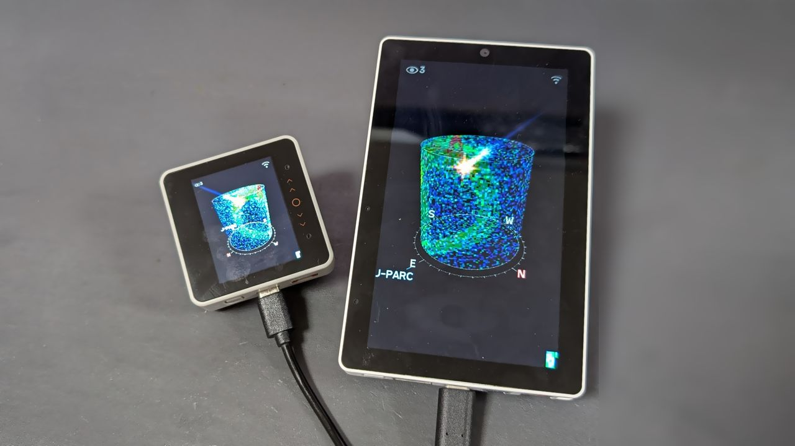

# Tiny Kamiokande クライアント

[English](README.md) | 日本語



Tiny Kamiokande の MCU 向けクライアント。
[Super-Kamiokande Realtime Monitor](https://www-sk.icrr.u-tokyo.ac.jp/realtimemonitor/) が公開しているイベントディスプレイ画像を
Tiny Kamiokande のサーバが解析したデータを取得し、検出器の 3D モデルに貼り付けて、サーバが推定した粒子の軌跡とともに表示します。

表示は学術的な正しさを保証しません (軌跡、方位ともに画像と公開情報からの推定です)。

## 対応機種

- M5Stack CoreS3 (ESP32-S3)
- M5Stack Tab5 (ESP32-P4 + ESP32-C6)
- ホスト版 (PC。保存した応答からフレームを PNG に書き出す確認用)

## コンパイル済みバイナリ

コンパイル済みのファームは [Releases](https://github.com/shapoco/tiny-kamiokande-client/releases) からダウンロードできます。
zip を展開し、機種のディレクトリにある `upload.sh` で書き込みます ([esptool](https://github.com/espressif/esptool) が必要です)。

```sh
m5cores3/upload.sh /dev/ttyACM0   # CoreS3
m5tab5/upload.sh /dev/ttyACM0     # Tab5
```

Tab5 は書き込んだ後に C6 の更新が必要です (下記)。

## ソースからのビルドに必要なもの

- [ESP-IDF](https://github.com/espressif/esp-idf) 5.5 (環境変数 `IDF_ROOT`、既定 `~/esp/5.5/esp-idf`)
- [ShapoGFX](https://github.com/shapoco/shapo-gfx) のクローン (環境変数 `SHAPOGFX_PATH`、既定 `~/shapo-gfx`)

## ビルドと書き込み

```sh
impl/m5cores3/run.sh /dev/ttyACM0   # CoreS3 (ポートは環境に合わせる)
impl/m5tab5/run.sh /dev/ttyACM0     # Tab5
impl/m5cores3/build.sh -DTKAPP_DEMO=1   # 通信せず埋め込みのサンプルを表示するデモモード
```

Tab5 は出荷時の ESP32-C6 のファームのままでは HTTPS が通らないため、最初に C6 の更新が必要です。
Tab5 のファームには C6 の更新用ファームが埋め込まれており、USB シリアルのコンソールで `c6ota` コマンドを実行すると更新できます (約 11 秒。[SPEC.md](SPEC.md) 5.6)。

## WiFi の設定

画面右上の WiFi アイコンをタップすると設定画面が開きます。USB シリアルのコンソールで `wifi` コマンドを使って設定することもできます。
設定は本体の NVS に保存されます。

## ドキュメント

仕様、サーバ API、実装の詳細は [SPEC.md](SPEC.md) を参照してください。
