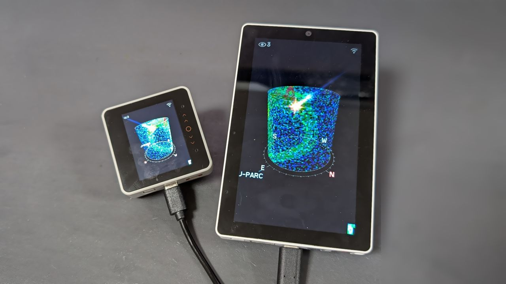

# Tiny Kamiokande Client

English | [日本語](README.ja.md)



An MCU client for Tiny Kamiokande.
It fetches data that the Tiny Kamiokande server has extracted from the event display images published by the
[Super-Kamiokande Realtime Monitor](https://www-sk.icrr.u-tokyo.ac.jp/realtimemonitor/), maps it onto a 3D model of the detector,
and shows it together with the particle tracks estimated by the server.

A web version for PCs and smartphones is available at https://www.shapoco.net/tiny-kamiokande/.

The display is not guaranteed to be scientifically accurate (both the tracks and the orientation are estimated from the images and public information).

## Supported devices

- M5Stack CoreS3 (ESP32-S3)
- M5Stack Tab5 (ESP32-P4 + ESP32-C6)
- Waveshare Pico-ResTouch-LCD-2.8 + Raspberry Pi Pico 2 W (RP2350)
- Host build (PC; renders frames from saved responses to PNG for checking)

## Prebuilt binaries

Prebuilt firmware can be downloaded from [Releases](https://github.com/shapoco/tiny-kamiokande-client/releases).
Extract the zip and flash the firmware in the directory for your device.

For M5Stack devices, use `upload.sh` ([esptool](https://github.com/espressif/esptool) is required).

```sh
m5cores3/upload.sh /dev/ttyACM0   # CoreS3
m5tab5/upload.sh /dev/ttyACM0     # Tab5
```

The Pico-ResTouch-LCD-2.8 + Pico 2 W needs no tools:

1. Hold the BOOTSEL button on the Pico 2 W while connecting it to your PC with a USB cable (you can release the button once it is connected).
2. A drive named `RP2350` appears. Copy `pico_restouch_lcd_2_8/tiny_kamiokande_pico_restouch_lcd_2_8.uf2` to it.
3. When the copy finishes, the board restarts and runs the firmware (the drive disappears).

The Tab5 needs its C6 updated after flashing (see below).

## Requirements for building from source

- [ESP-IDF](https://github.com/espressif/esp-idf) 5.5 (environment variable `IDF_ROOT`, default `~/esp/5.5/esp-idf`)
- A clone of [ShapoGFX](https://github.com/shapoco/shapo-gfx) (environment variable `SHAPOGFX_PATH`, default `~/shapo-gfx`)
- For the Pico: the [Pico SDK](https://github.com/raspberrypi/pico-sdk) 2.2 (environment variable `PICO_SDK_PATH`, default `~/pico/pico-sdk`), the Arm GNU Toolchain and picotool

## Build and flash

```sh
impl/m5cores3/run.sh /dev/ttyACM0   # CoreS3 (adjust the port to your environment)
impl/m5tab5/run.sh /dev/ttyACM0     # Tab5
impl/m5cores3/build.sh -DTKAPP_DEMO=1   # Demo mode: shows the embedded samples without networking
impl/pico_restouch_lcd_2_8/build.sh     # Pico-ResTouch-LCD-2.8 + Pico 2 W (-DTKAPP_DEMO=ON for the demo mode)
impl/pico_restouch_lcd_2_8/flash.sh     # Flash with picotool
```

On the Tab5, HTTPS does not work with the factory firmware of the ESP32-C6, so the C6 must be updated first.
The Tab5 firmware embeds the C6 update image; run the `c6ota` command on the USB serial console to update it (about 11 seconds; see [SPEC.md](SPEC.md) 5.6).

## WiFi settings

Tap the WiFi icon at the top right of the screen to open the settings screen. You can also configure it with the `wifi` command on the USB serial console.
The settings are stored in the device's NVS (on the Pico, in the last sector of the flash).

The strip above the event log at the bottom of the screen is a timeline of the last hour. It shows only the events that stopped in the detector (yellow) or started inside it (red); tap a dot to replay that event, and tap ▶ LIVE to return to the live view.

The Pico-ResTouch-LCD-2.8 has a single-touch screen, so instead of pinching, double-tap the detector to zoom in and hold it to zoom out.

## Documentation

See [SPEC.md](SPEC.md) (Japanese) for the specification, the server API and implementation details.
